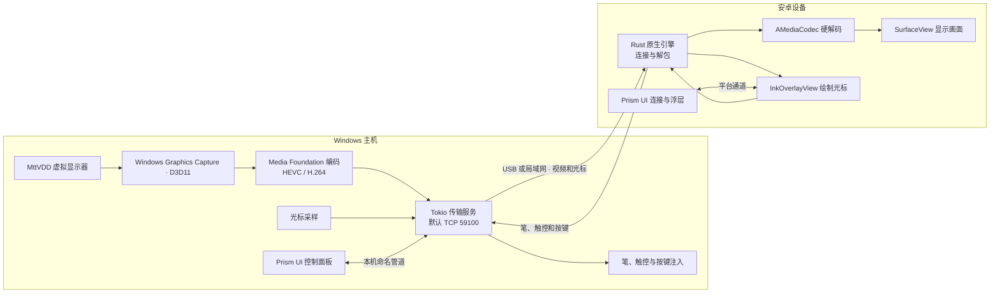

# ExtScreen 架构说明

ExtScreen 将 Windows 虚拟显示器的画面传到安卓设备，并将触控、笔压、倾斜和按键传回电脑。视频流与光标更新分别传输。

## 代码组织

| 目录或组件 | 职责 |
| --- | --- |
| `common/`（`extscreen-common`） | 定义 24 字节包头、控制消息、输入事件、NAL 辅助函数、局域网发现格式和配对算法。 |
| `host/`（`extscreen-host`） | 采集、编码和传输画面，注入输入事件，管理托盘、虚拟显示器和控制面板接口。 |
| `ui/` | Flutter + Prism UI 框架。包含 Windows 控制面板、安卓连接与设置页、串流浮层和中英文/主题设置。 |
| `client/native/`（`extscreen-client-native`） | Rust 安卓原生库，处理连接、握手和解码，把画面送到应用的 `Surface`。 |
| `client/app/` | Kotlin 安卓宿主，负责 USB 与网络发现、视频 Surface、触控和笔输入采样、笔迹预绘，以及连接 Flutter 界面的平台通道。 |
| `driver/` | 虚拟显示驱动的显示模式与配置脚本。 |
| `installer/` | 可选 Inno 安装器脚本及随 Windows 便携 ZIP 分发的驱动原件。 |

## 界面与原生引擎

Windows 控制面板 `extscreen.exe` 与 Rust 主机 `extscreen-host.exe` 分别运行，通过本机同用户命名管道传递状态和操作。关闭控制面板窗口后仍可从托盘打开。首次 USB 直连时，主机在控制面板发出确认请求，关闭或隐藏提示以及超时都会拒绝本次配对。

Windows runner 按每显示器 DPI 缩放，换屏时采用系统建议的窗口边界。显示器矩形和输入注入仍使用物理像素坐标。

安卓端由 Kotlin 管理视频 `SurfaceView`、光标、笔迹和触控。Flutter 通过平台通道读取状态并提交设置。悬浮层接收控件范围内的触摸，其余触摸沿用原生输入路径。

## 视频数据流

1. **创建虚拟屏。** MttVDD 间接显示驱动向 Windows 提供独立显示器。设备连接时，主机将虚拟屏加入桌面，优先选用设备的原生分辨率，或从驱动提供的模式中选择尺寸接近的选项。断开连接后，主机卸下虚拟屏。守护进程与登录任务负责处理主机意外退出时残留的虚拟屏。`host/src/capture/virtual_display.rs`
2. **采集。** Windows Graphics Capture 将虚拟屏画面以 D3D11 纹理交给编码器。主机缓存最近一帧和可解码的关键帧，以便设备连接时尽快显示静止桌面。`host/src/capture/wgc.rs`
3. **编码。** 优先使用 GPU 上的 Media Foundation 编码器。设备支持 HEVC 解码时优先选择 HEVC，其次使用 H.264。OpenH264 提供软件回退路径。低延迟配置使用 CBR、禁用 B 帧，并限制编码器在途帧数。自适应码率根据链路选择起始值，在链路可以承载时提高，发生阻塞时降低。`host/src/capture/encoder.rs`、`host/src/capture/rate_control.rs`
4. **发送。** 原始 NAL 单元加上 24 字节包头后写入 TCP。视频队列最多保留两帧，队列满时优先保留新画面。
5. **解码和显示。** 安卓端将数据送入 `AMediaCodec`，按面板刷新节奏输出到 `SurfaceView`。丢帧导致解码需要重新同步时，客户端请求关键帧。`client/native/src/decoder.rs`

## 光标与输入回传

- **鼠标光标。** Windows 端通过 `GetCursorInfo` 采集坐标和可见性，按虚拟屏范围归一化后单独发送。形状变化时附带 Windows 光标位图及热点。安卓视图在已经挂载且应用处于前台时，使用 `Choreographer` 刷新叠加层。视频画面静止时，光标仍可独立更新。
- **触控和笔。** 安卓端对触摸、笔压与悬停事件进行采样，包含高频历史样本，经当前缩放映射为 0 到 1 的坐标后回传。主机使用 Windows 的合成笔设备和触控设备注入事件，使绘图程序能接收笔压与倾斜。`host/src/input/pointer_injector.rs`
- **落点和快捷操作。** 安卓叠加层在触控或笔操作时绘制落点及短时笔迹，跟随 Windows 的光标状态恢复鼠标指针。快捷栏按键由主机通过 `SendInput` 注入。

## 连接方式

| 方式 | 建链与数据传输 | 配对 |
| --- | --- | --- |
| **USB 网络共享** | Android 使用 RNDIS 或 USB NCM，复用 Windows 内置网络驱动。主机识别网卡后，向安卓网关单播发现消息。`--configure-usb-tether` 调整电脑原有网络与 USB 共享网卡的优先级。安卓端探测 `rndis*`、`ncm*` 或 `usb*` 子网。重新插线导致子网改变时，已配对设备可以重新发现主机。 | 首次使用 6 位 PIN 进行 SPAKE2 配对，随后用 ChaCha20-Poly1305 加密并认证数据包。 |
| **Wi-Fi 或局域网** | 使用 UDP `59101` 发现主机，再连接默认 TCP `59100`。 | 使用与 USB 网络共享相同的认证和加密。 |
| **USB 配件模式（AOA）** | Windows 通过 WinUSB 将设备切换到 Android Open Accessory 模式，再把 USB 批量传输接到本机 TCP 服务。`ExtScreen-USB-Setup.cmd` 可为设备绑定系统自带的 WinUSB 驱动。 | Windows 首次确认设备并签发设备密钥。已配对设备通过 SPAKE2 证明持有密钥，配对后的串流经本地线缆传输。 |
| **ADB 直连** | 主机在设备接入时通过 ADB 反向转发把安卓端的 TCP `59100` 接到电脑。双方使用同一 Windows 用户启动的 ADB 通道。 | 与配件模式相同。 |

新设备连续输错五次 PIN 时，主机会更新 PIN 并暂停配对。设备保存与该电脑对应的密钥后，可以直接重连。

任意时刻只有一个设备使用串流会话。其他设备接管时，主机向原设备发送 `SessionTaken`，原设备会停止自动重连。
